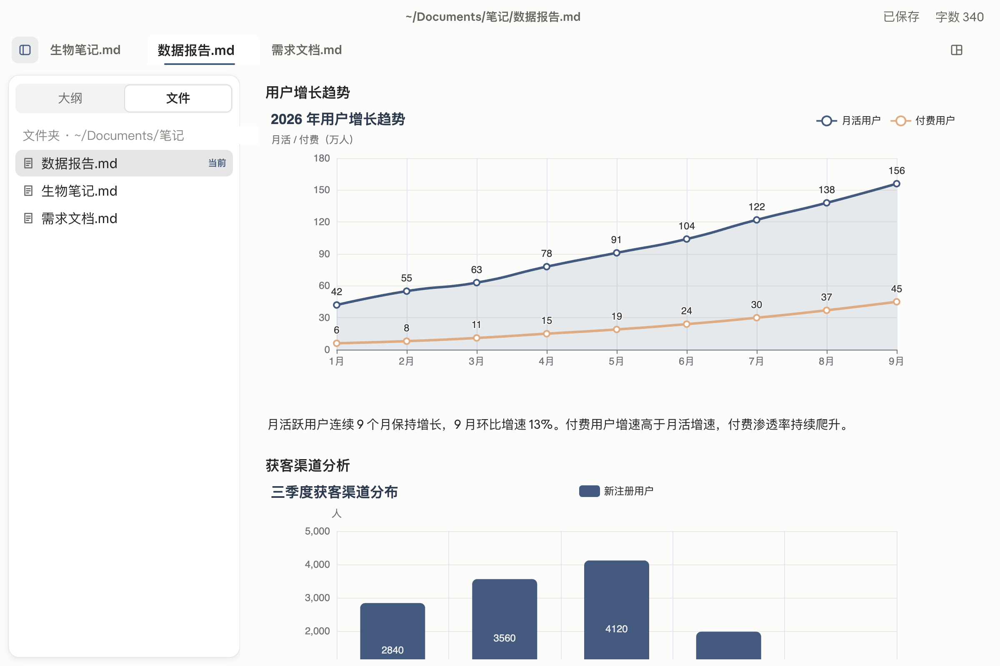
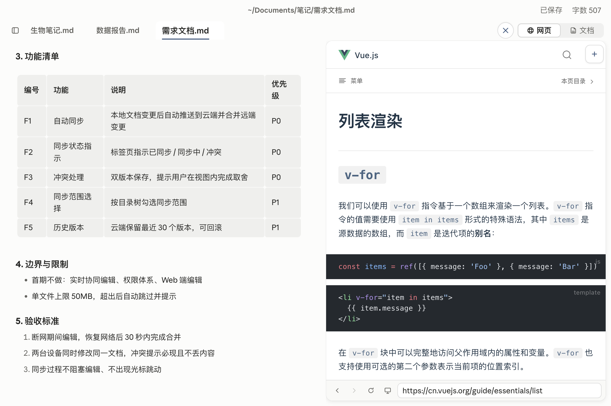
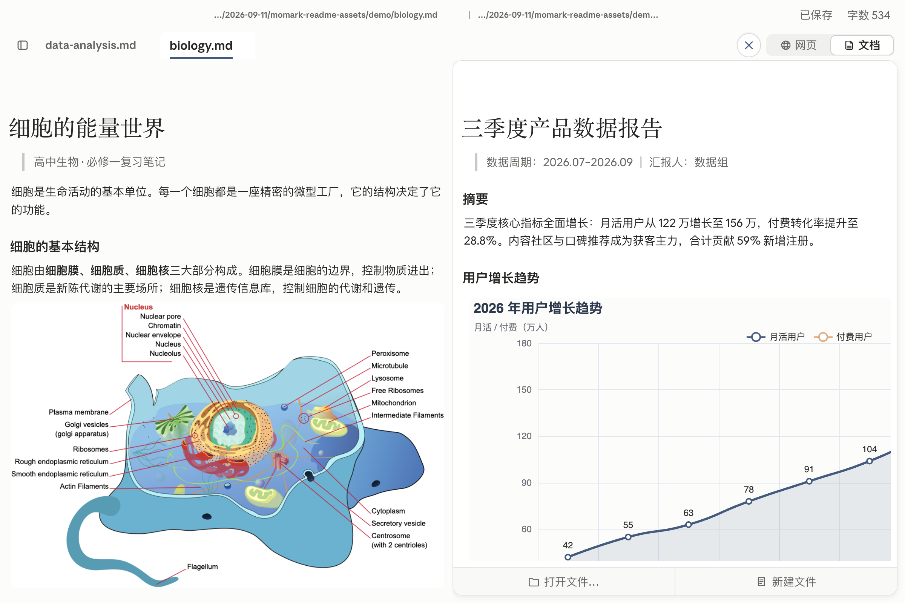
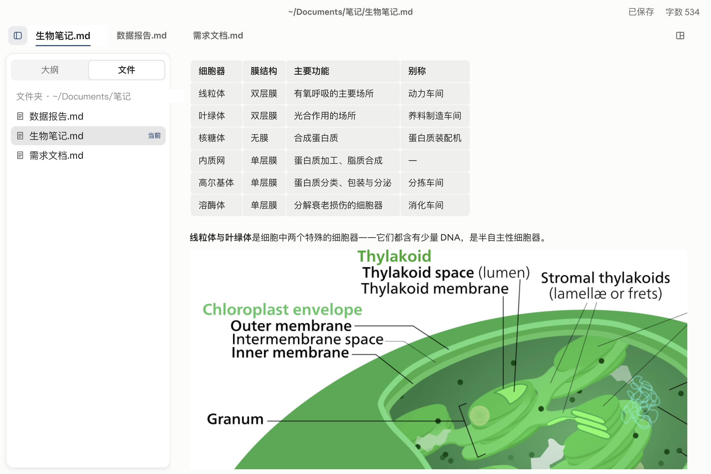

<div align="center">


[中文](README.md) | **English**

# MoMark 墨记

A Chinese-first Markdown editor for macOS

<a href="https://github.com/lixiaoshuang79/momark/releases/latest"></a>

<a href="LICENSE"></a>
<a href="https://github.com/lixiaoshuang79/momark/stargazers"></a>

</div>

MoMark is a one-person project. It runs on macOS only, for now.

Writing a spec, a report, anything long, your material ends up scattered. Research sits in a browser, reference docs in another window, charts in some other tool, review comments somewhere in a chat thread. MoMark tries to pull all of that back into one window. The right pane holds a web page or a second document. Charts and clickable prototypes go into `html` blocks and run inside the document. And when an AI is doing the revising, you annotate the text point by point and hand over the whole batch at once.

It's Chinese-first, and a lot of that work went into the least visible part: IME input. Typing in a table cell, or committing text in a soft-wrapped paragraph, doesn't drop characters or throw the cursor around.

## What's different

### HTML blocks are live

Write an `html` code block and MoMark shows the rendered result, not the source. Charts and clickable prototypes sit right in the document. A prototype in a spec no longer needs its own link.

**Blocks can include `<script>`, and it runs.** The whole block executes inside a `sandbox="allow-scripts"` iframe. Scripts can't reach the editor or the document, and can't touch your local files.



<sub>A data report. Both charts are html blocks in the document; this is what you see when you open it.</sub>

- Control bar in the bottom-right corner: zoom from 50% to 200%, drag to resize the viewport. The preview height follows the content, from 60 to 1200px.
- The size and zoom you set are saved with the document. Reopen it and nothing has moved.
- The HTML and its script live inside the `.md` file. Send that one file to someone, open it offline, it still renders.
- Already have an `.html` file? Paste it in. A bubble asks what you want. Embed it in the document: styles, scripts and images from the same folder get inlined, and you end up with a single `.md`. Or upload it and insert a link: it goes through the upload service you've configured, and only the link stays in the doc.
- Export to HTML and the block is still a live sandboxed frame. Double-click the file and you can click around and switch tabs; the bottom-right toolbar still zooms and resizes. Export to PDF or Word and it becomes a proportional snapshot, exactly what was on screen.

### The right pane: a web page, or another document

The right pane has two modes, web and document. One click switches between them.

Web mode is a small browser. Its own tabs and address bar, several pages to flip between, back and forward. Zoom with ⌘+ / ⌘- / ⌘0, anywhere from 0.25× to 3×, or fit to width. Looking something up doesn't mean leaving the window.



<sub>Writing and looking things up. A spec on the left, technical docs open in the web pane.</sub>

Document mode holds a second Markdown file. Drag a tab out and it lands in the right pane, and you edit both side by side. The scrollbar sits in the divider between them, not on top of your text.



<sub>Two documents side by side. Notes on the left, the data report on the right, its charts still rendering.</sub>

### Annotations an AI can act on

This one is for people who revise with an AI. The hard part usually isn't the rewrite. It's telling the model where. "That paragraph in section three" lands on the wrong paragraph more often than it should.

1. Select a passage, hit annotate on the toolbar, write one line about what should change. The text gets a light ink-blue highlight and a number; the annotations panel in the right pane keeps track of every note.
2. When the round is done, copy everything with one click. You get structured text: section path, line number, the quoted original, the surrounding paragraph, your request. Paste it straight into an AI agent.
3. Copied notes are marked as copied. Once the AI has edited the file, MoMark compares and tells you, note by note, whether the content changed. Check them off and archive them to history.

Annotations live in the app's data directory. **Not a single character goes into the `.md`.** The document you hand over stays clean.

Requests you make all the time, like "cite a source for this number", can be saved as phrase chips. Select text, click a chip, and the annotation is done.

### Chinese input

In Chinese, a keystroke isn't a character. You type pinyin, the IME holds it in a composition window, and characters only get committed when you pick a candidate. If the editor re-renders while that's happening, the commit can get lost, or the caret ends up somewhere else. Editors that draw their own view are where this bites hardest, and it's easy to miss if you never type CJK.

MoMark fixes two spots where this goes wrong:

- IME input inside table cells, fixed along the whole input path.
- In soft-wrapped paragraphs, whatever the IME commits is kept intact.

The result is plain: you write Chinese, no characters go missing, the cursor stays where it was.

The UI ships with more than ten languages, Chinese first. The Chinese UI text was redone from scratch, not lifted from an off-the-shelf translation.

## Everything else

| Area         | What's there                                                                                                                                                                                             |
| ------------ | -------------------------------------------------------------------------------------------------------------------------------------------------------------------------------------------------------- |
| Markdown     | CommonMark, GitHub Flavored Markdown; KaTeX math; Mermaid and PlantUML diagrams                                                                                                                          |
| Modes        | Source mode, typewriter mode, focus mode                                                                                                                                                                 |
| Editing core | Block-based document model. Incremental updates with ot-json1 + ot-text-unicode, snabbdom for the view layer, marked for parsing, rxjs for event streams                                                 |
| Look         | Ink blue `#3D5A80` as the main color; light and dark themes; asymmetric sidebar motion; hairline scrollbars that show up while you scroll                                                                |
| Export       | HTML, PDF, Word                                                                                                                                                                                          |
| Day to day   | Command palette, full-text search, image upload (through the upload service you configure), in-app update check and download                                                                             |
| Isolation    | Fully sandboxed renderer (`contextIsolation`, `sandbox: true`); Node capabilities exposed only through a `contextBridge` allowlist. Its own data directory, so it never gets in the way of other editors |



<sub>Illustrated notes. A table and color figures in the same document.</sub>

## Install

Download the dmg or zip from [Releases](https://github.com/lixiaoshuang79/momark/releases/latest). Open the dmg and drag 墨记 into Applications. 墨记 is MoMark's app name on disk, so that's what you'll see in Finder.

### macOS blocks it on first launch

MoMark isn't notarized by Apple. The first time you open it, macOS says Apple could not verify “墨记” is free of malware that may harm your Mac or compromise your privacy. To let it through:

1. Open System Settings → Privacy & Security, and in the Security section click **Open Anyway**.
2. Open MoMark again and choose Open in the dialog.

Since macOS 15 the old right-click → Open trick no longer works, so don't bother with it.

If the message says the app is damaged and can't be opened, run this in Terminal:

```bash
xattr -cr /Applications/墨记.app
```

## Build from source

Requires Node.js ≥ 20.19 (22 recommended) and pnpm ≥ 10.

```bash
pnpm install
pnpm build:mac          # arm64 by default; for Intel Macs use pnpm build:mac:x64
```

Output:

- App: `dist/mac-arm64/墨记.app`
- Installers: `dist/momark-mac-arm64-1.5.6.dmg`, `dist/momark-mac-arm64-1.5.6.zip`

## Development

```bash
pnpm dev                # dev instance; the renderer runs on localhost:9333
```

Stack: Electron 42 · Vue 3.5 · TypeScript (strict) · Pinia · electron-vite 5 · electron-builder 26, organized as a pnpm monorepo.

## Project structure

| Directory          | What it is                                     |
| ------------------ | ---------------------------------------------- |
| `packages/desktop` | Electron desktop app (main process + renderer) |
| `packages/muya`    | Block-based editing core (TypeScript)          |
| `packages/muyajs`  | Previous editing core, being retired           |
| `packages/website` | Website / documentation site                   |
| `docs/`            | Developer docs                                 |

## Changelog

Current version: 1.5.6, released 2026-10-13. What changed in each version is on the [Releases](https://github.com/lixiaoshuang79/momark/releases) page.

## License

[AGPL-3.0-only](LICENSE). Some of the code remains under the MIT license; see [NOTICE.md](NOTICE.md) for the scope.

The biology illustrations in the screenshots on this page come from Wikimedia Commons (public domain / CC BY-SA 3.0). Per-image sources and licenses: [docs/screenshots/figure-sources.txt](docs/screenshots/figure-sources.txt).
