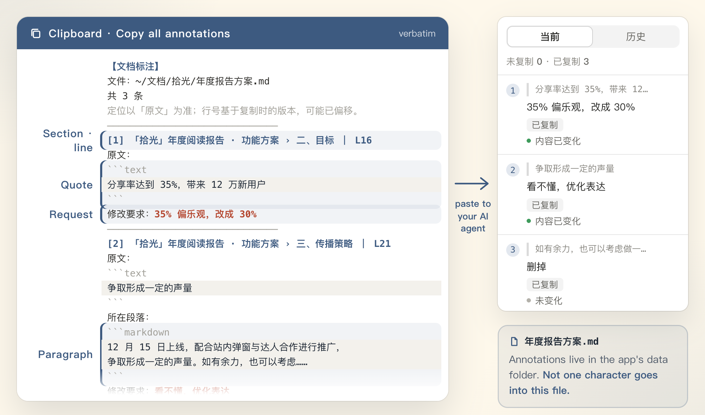
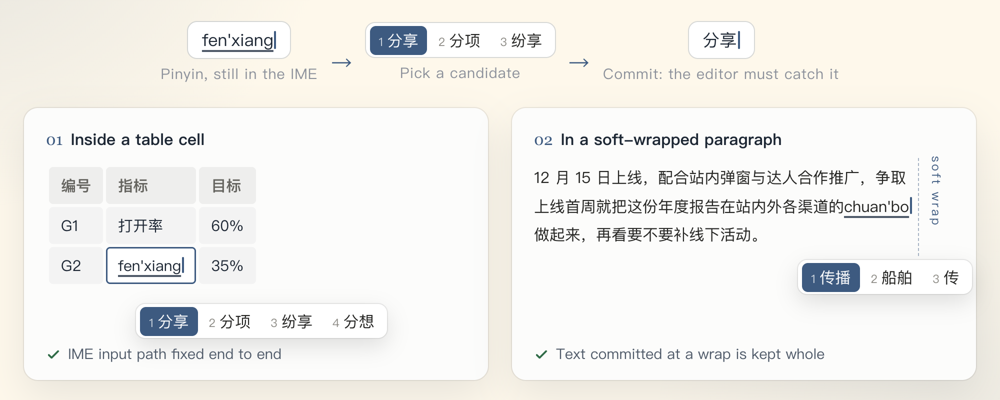

<div align="center">


[中文](README.md) · **English**

<a href="https://github.com/lixiaoshuang79/momark/releases/latest"></a>

<a href="LICENSE"></a>

</div>

MoMark (墨记) is a Markdown editor for macOS, built Chinese-first. I make it alone, mostly for my own writing.

What I write most is product specs. A decent spec needs a prototype you can click, reference pages open while you write, and these days a round of edits handed to an AI. That used to mean juggling several windows. MoMark keeps it in one:

- the prototype lives in the document as an `html` block, and runs there;
- the side panel holds a web page, or a second document;
- review notes are pinned to the exact text, then copied to your AI in one go.

One more thing, easy to overlook and the part I'm fussiest about: Chinese input. Typing in a table cell, committing text right at a line wrap: no lost characters, no jumping cursor.

[Download 1.5.6](https://github.com/lixiaoshuang79/momark/releases/latest) · [Blocked on first launch?](#if-macos-blocks-the-first-launch) · [Build from source](#build-from-source)

## html blocks that actually run


Write an `html` code block in your `.md` and MoMark shows what it renders, not the source. On the left is what the file really contains; on the right is what you see when you open it. A prototype in a spec, a chart in a data report: it sits right in the text, no separate link to send along.

`<script>` tags run too. Getting a script to run is easy. Keeping it inside its own box is the actual work:


- The whole html block runs inside an iframe with `sandbox="allow-scripts"`. Its scripts can't reach the editor UI or the document, and can't touch local files.
- One layer out, the editor's own renderer runs with `sandbox: true` and `contextIsolation`. Anything that needs Node goes through a `contextBridge` allowlist, and nowhere else.

Day to day:

- A control bar in the bottom-right corner zooms from 50% to 200%; drag the corner to resize the viewport. The preview height follows the content, between 60 and 1200 px.
- The size and zoom you set are saved with the document. Next time it opens the same way.
- The HTML and its scripts are written into the `.md` itself. Send one file; it renders offline on the other end.
- Already have an `.html` file? Paste it in. A popover offers two ways: embed it in the document, which inlines the stylesheets, scripts and images from the same folder and turns it into a single `.md`; or upload it and insert a link, which goes through the upload service you've configured and leaves just a link in the document.
- Export to HTML and the block stays a live sandboxed frame: clickable, tabs still switch, the corner toolbar still zooms and resizes. Export to PDF or Word and it becomes a proportional snapshot, exactly as it looked on screen.

## Review notes your AI can act on

When you ask an AI to revise a document, the hard part is rarely the revising. It's saying where. "That paragraph in section three", "the number up top": it often edits the wrong spot.


Select a passage, click the annotate button (标注) in the toolbar, write one line. The text keeps only a faint ink-blue highlight and a number; the annotations panel on the right lists every note.

Things you say over and over, like "unclear, rephrase" or "cut this", can be saved as phrases. Select text, click once, done.

When the round is complete, copy them all with one click:



What lands on the clipboard is structured: section path, line number, the quoted original, the surrounding paragraph, and your request. Paste the whole thing into an AI agent and it doesn't have to guess where each change goes.

Notes you've copied are marked as copied. After the AI edits the document, MoMark compares against the original and tells you, note by note, whether the content changed or not. Anything it skipped stands out. Once checked, they move to the history tab.

Annotations are stored in the app's data folder. Not one character is written into the `.md`. I don't want review marks mixed into the source; the file you hand over should be clean.

## The side panel: a small browser, or a second document


The right-hand panel has two modes, Web and Doc, one click apart.

Web mode has its own tabs and address bar: switch between pages, go back and forward. ⌘+ / ⌘- / ⌘0 zoom from 0.25× to 3×, or just fit to width. Research without leaving the window.

Doc mode holds another Markdown file. Drag a tab into the panel and the two documents sit side by side, both editable. The scrollbar lives on the divider between them, out of the text's way.

## Chinese input



Chinese isn't one key, one character. You type pinyin, it waits in the input method, and only when you pick a candidate does the text get committed to the document. If the editor redraws at that moment, characters can vanish and the cursor can jump.

MoMark fixed two places where that happens:

- IME input inside table cells, fixed along the whole path;
- in long soft-wrapped paragraphs, text committed by the input method is kept intact.

The result: no lost characters, no jumping cursor. People tend to blame the input method for this kind of bug. It's usually the editor failing to catch the commit.

The interface ships with more than ten languages, Chinese first. The Chinese UI was reworked by hand, not a translation file dropped in.

## Also included

| Area          | What's there                                                                                                                                 |
| ------------- | -------------------------------------------------------------------------------------------------------------------------------------------- |
| Markdown      | CommonMark, GitHub Flavored Markdown; KaTeX math; Mermaid and PlantUML diagrams                                                              |
| Editing modes | Source mode, typewriter mode, focus mode                                                                                                     |
| Export        | HTML, PDF, Word                                                                                                                              |
| Everyday      | Command palette, full-text search, image upload (through the upload service you configure), in-app update check and download                 |
| Look          | Ink blue `#3D5A80` as the main color, light and dark themes; asymmetric sidebar motion; hairline scrollbars that appear only while scrolling |
| Data          | Its own data folder, so it never collides with other editors                                                                                 |

## Install

Download the dmg or zip from [Releases](https://github.com/lixiaoshuang79/momark/releases/latest). Open the dmg and drag 墨记 into Applications.

Builds are primarily arm64 (Apple silicon). On an Intel Mac you can build the x64 version yourself; see [Build from source](#build-from-source).

### If macOS blocks the first launch

MoMark isn't notarized by Apple. The first time you open it, macOS says it can't verify that "墨记" is free of malware that may harm your Mac or compromise your privacy. To let it through:

1. Open System Settings → Privacy & Security, and under Security click "Open Anyway".
2. Open MoMark again and choose "Open" in the dialog.

Since macOS 15, the old right-click → Open trick no longer works, so don't bother.

If the message says the app "is damaged and can't be opened", run this in Terminal:

```bash
xattr -cr /Applications/墨记.app
```

## Build from source

Requires Node.js ≥ 20.19 (22 recommended) and pnpm ≥ 10.

```bash
pnpm install
pnpm build:mac          # arm64 by default; for Intel use pnpm build:mac:x64
```

Output:

- App: `dist/mac-arm64/墨记.app`
- Installers: `dist/momark-mac-arm64-1.5.6.dmg`, `dist/momark-mac-arm64-1.5.6.zip`

For development, `pnpm dev` runs the renderer on `localhost:9333`.

## Stack and repository layout

Electron 42 · Vue 3.5 · TypeScript (strict) · Pinia · electron-vite 5 · electron-builder 26, organized as a pnpm monorepo.

The editing core is a block-level document model: marked parses Markdown, ot-json1 + ot-text-unicode apply incremental updates, snabbdom renders the view, rxjs carries the event streams.

| Directory          | What it is                                       |
| ------------------ | ------------------------------------------------ |
| `packages/desktop` | Desktop app (Electron main + renderer processes) |
| `packages/muya`    | Block-level editing core (TypeScript)            |
| `packages/muyajs`  | Previous editing core, being retired             |
| `packages/website` | Website / docs site                              |
| `docs/`            | Developer docs                                   |

## Releases

Current version: 1.5.6, released 2026-10-13. What changed in each version is on the [Releases](https://github.com/lixiaoshuang79/momark/releases) page.

## License

[AGPL-3.0-only](LICENSE). Some code remains under the MIT license; see [NOTICE.md](NOTICE.md) for the scope.
