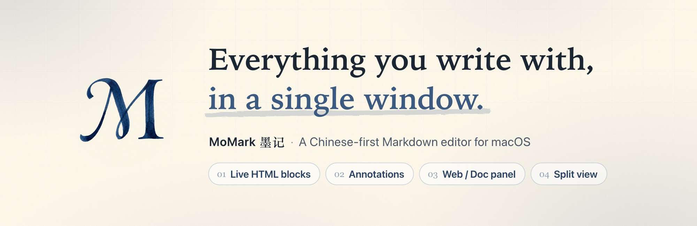
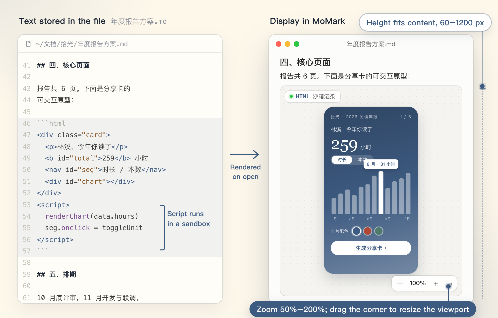
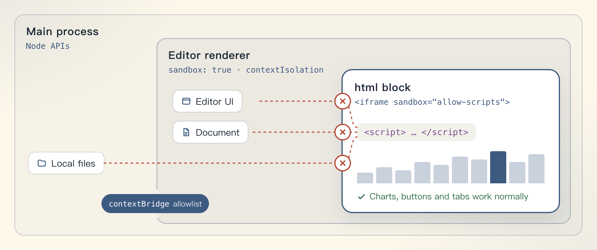
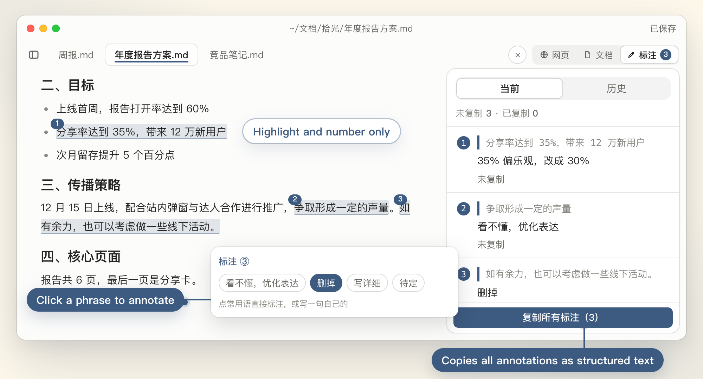
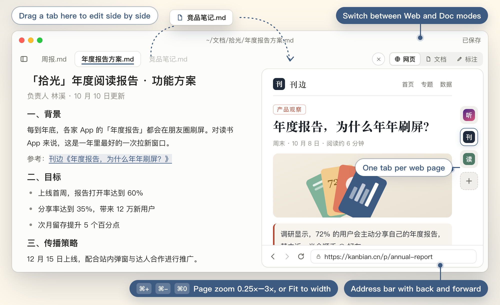

<div align="center">



[中文](README.md) · **English**

<a href="https://github.com/lixiaoshuang79/momark/releases/latest"></a>

<a href="LICENSE"></a>

</div>

MoMark (墨记) is a Chinese-first Markdown editor for macOS. In addition to standard Markdown editing, it provides three main features:

- [Live HTML blocks](#live-html-blocks): `html` code blocks in a document are displayed as rendered pages, and their scripts run in a sandbox.
- [Annotations](#annotations): review comments are attached to specific passages, then copied together as structured text for an AI to act on.
- [Web and document side panel](#web-and-document-side-panel): the panel to the right of the editor shows a web page, or a second document dragged in for side-by-side editing.

[Download](https://github.com/lixiaoshuang79/momark/releases/latest) · [If macOS blocks the first launch](#if-macos-blocks-the-first-launch) · [Build from source](#build-from-source)

## Live HTML blocks



When a `.md` file contains an `html` code block, MoMark displays the rendered result rather than the source. The left side of the figure shows the text stored in the file; the right side shows the same file opened in MoMark. Interactive prototypes in product specs and charts in data reports can be embedded in the body this way, with no separate link to distribute.

### Script isolation

Scripts inside the block run normally, but their reach is limited to the block itself:



- The entire html block runs in an iframe with `sandbox="allow-scripts"`. Scripts in the block cannot access the editor UI or the document content, and cannot read or write local files.
- The editor's own renderer process also runs with `sandbox: true` and `contextIsolation`. Node capabilities are available only through a `contextBridge` allowlist.

### Usage

- Zoom and viewport: the control bar in the bottom-right corner of the block zooms from 50% to 200%, and the viewport can be resized by dragging. The preview height adjusts to the content, within a range of 60–1200 px.
- Saved size: the size and zoom level are saved with the document and restored when it is reopened.
- Single-file distribution: the HTML and its scripts are stored in the `.md` file itself. A recipient can open the file offline, and the block still renders.
- Pasting an `.html` file: when an existing `.html` file is pasted, MoMark shows a popover with two options:
  - Embed in the document: inlines the stylesheets, scripts and images from the same folder, and converts the result into a single `.md` file.
  - Upload and insert a link: uploads the file through the configured upload service and leaves only a link in the document.
- Export: in an HTML export, the block remains an interactive sandboxed frame. It can be clicked, its tabs can be switched, and the corner toolbar still zooms and resizes it. In a PDF or Word export, the block becomes a proportional snapshot that matches the on-screen display.

## Annotations

Annotations record review comments against specific passages and pass them to an AI together with their locations. Each comment carries its section path, line number and quoted original text, so the AI does not have to infer the target from a description such as "the paragraph in section three".



### Adding annotations

1. Select a passage, click the annotate button (标注) in the toolbar, and enter a one-line comment.
2. The passage receives a faint ink-blue highlight and a number. The text itself is not changed.
3. The Annotations panel on the right lists every annotation for review and management.

Requests that recur often, such as "unclear, rephrase" or "cut this", can be saved as phrases. Selecting text and clicking a saved phrase creates the annotation in a single step.

### Copying and verifying


When a round of review is complete, click Copy all annotations (复制所有标注) to produce structured text. Each entry contains the section path, line number, quoted original, surrounding paragraph and requested change. Pasted into an AI agent, this text lets each change be located precisely.

Copied entries are marked as copied. After the AI edits the document, MoMark compares it with the original and reports, entry by entry, whether the content has changed. Entries reported as unchanged are the comments that have not yet been addressed. Verified annotations can be archived to the history list.

Annotation data is stored in the application's data directory, and nothing is written to the `.md` file. The document you deliver stays unmodified.

## Web and document side panel



The right-hand panel has two modes, Web and Doc, and can be switched between them at any time.

Web mode: the panel has its own tabs and address bar and supports switching between pages and navigating back and forward. Page zoom uses ⌘+ / ⌘- / ⌘0 within a range of 0.25× to 3×; Fit to width is also available. Reference material can be consulted without leaving the editor window.

Doc mode: drag a tab into the panel to place that document beside the current one, with both documents editable. The scrollbar sits on the divider between the two columns and does not overlap the text.

## Other features

For Chinese input, MoMark fixes the complete IME input path in table cells, and preserves text committed by the input method at soft line wraps in long paragraphs; characters are not lost and the cursor does not jump. The interface ships with more than ten languages, with Chinese as the first priority, and the Chinese interface text has been reworked.

| Area          | Details                                                                                                                                      |
| ------------- | -------------------------------------------------------------------------------------------------------------------------------------------- |
| Markdown      | CommonMark, GitHub Flavored Markdown; KaTeX math; Mermaid and PlantUML diagrams                                                              |
| Editing modes | Source mode, typewriter mode, focus mode                                                                                                     |
| Export        | HTML, PDF, Word                                                                                                                              |
| Tools         | Command palette, full-text search, image upload (through the configured upload service), in-app update check and download                    |
| Appearance    | Ink blue `#3D5A80` as the primary color; light and dark themes; asymmetric sidebar animation; hairline scrollbars shown only while scrolling |
| Data          | A separate data directory that does not conflict with other editors                                                                          |

## Install

Download the dmg or zip from [Releases](https://github.com/lixiaoshuang79/momark/releases/latest). Open the dmg and drag 墨记 (MoMark) into the Applications folder.

Builds are provided primarily for arm64 (Apple silicon). On an Intel Mac, build the x64 version from source; see [Build from source](#build-from-source).

Release notes for each version are on the [Releases](https://github.com/lixiaoshuang79/momark/releases) page. Once installed, the app can check for and download updates itself.

### If macOS blocks the first launch

MoMark is not notarized by Apple. On first launch, macOS reports that it cannot verify that "墨记" is free of malware that may harm your Mac or compromise your privacy. To allow it to open:

1. Open System Settings → Privacy & Security, and under Security click Open Anyway.
2. Open MoMark again and choose Open in the dialog.

Since macOS 15, right-click → Open no longer bypasses this check.

If the message states that the app is damaged and can't be opened, run the following in Terminal:

```bash
xattr -cr /Applications/墨记.app
```

## Build from source

Requirements: Node.js ≥ 20.19 (22 recommended) and pnpm ≥ 10.

```bash
pnpm install
pnpm build:mac          # builds arm64 by default; for Intel use pnpm build:mac:x64
```

Build output is written to `dist/`:

- App: `dist/mac-arm64/墨记.app`
- Installers: `dist/momark-mac-arm64-<version>.dmg` and the matching `.zip`

For development, `pnpm dev` runs the renderer on `localhost:9333`.

## Stack and repository layout

Electron 42 · Vue 3.5 · TypeScript (strict) · Pinia · electron-vite 5 · electron-builder 26, organized as a pnpm monorepo.

The editing core uses a block-level document model: marked parses Markdown, ot-json1 and ot-text-unicode apply incremental updates, snabbdom renders the view, and rxjs handles event streams.

| Directory          | Contents                                           |
| ------------------ | -------------------------------------------------- |
| `packages/desktop` | Desktop app (Electron main and renderer processes) |
| `packages/muya`    | Block-level editing core (TypeScript)              |
| `packages/muyajs`  | Previous editing core, being retired               |
| `packages/website` | Website and documentation site                     |
| `docs/`            | Developer documentation                            |

## License

Released under [AGPL-3.0-only](LICENSE). Some code remains under the MIT license; see [NOTICE.md](NOTICE.md) for its scope.
