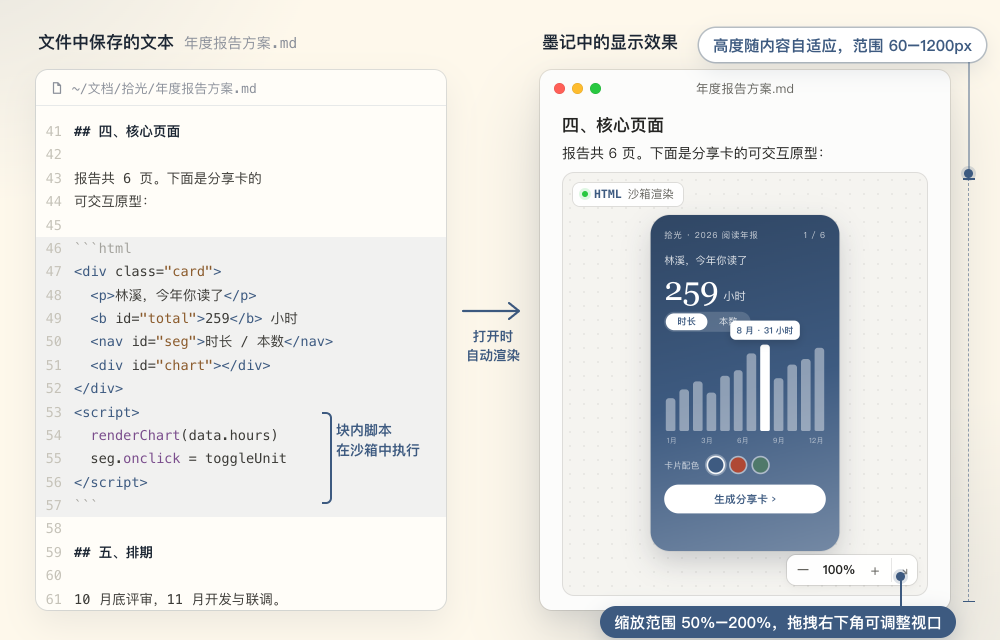
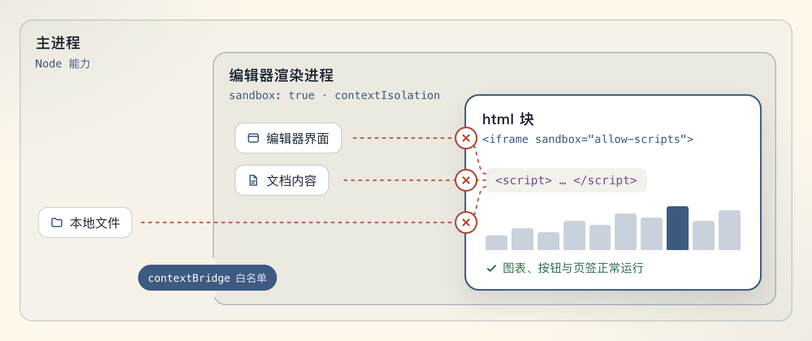
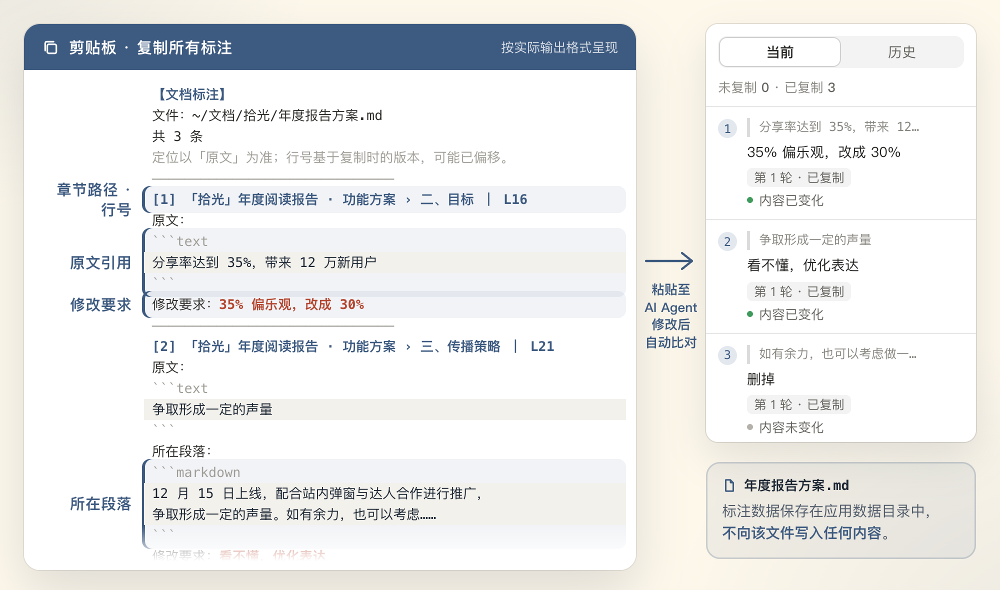

<div align="center">


**中文** · [English](README.en.md)

<a href="https://github.com/lixiaoshuang79/momark/releases/latest"></a>

<a href="LICENSE"></a>

</div>

墨记（MoMark）是 macOS 上的中文优先 Markdown 编辑器。在常规的 Markdown 编辑之外，墨记提供三项主要特性：

- [HTML 块内嵌渲染](#html-块内嵌渲染)：文档中的 `html` 代码块直接显示为渲染后的页面，块内脚本在沙箱中运行。
- [内容标注](#内容标注)：在原文上逐条记录修改意见，并整体复制为结构化文本，交给 AI 处理。
- [网页与文档右栏](#网页与文档右栏)：在编辑区右侧打开网页，或将另一篇文档拖入右栏并排编辑。

[下载安装包](https://github.com/lixiaoshuang79/momark/releases/latest) · [首次打开被 macOS 拦截](#首次打开被-macos-拦截) · [从源码构建](#从源码构建)

## HTML 块内嵌渲染



在 `.md` 文件中写入 `html` 代码块，墨记显示的是该代码渲染后的页面，而不是源码。上图左侧为文件中实际保存的文本，右侧为在墨记中打开后的效果。需求文档中的交互原型、数据报告中的图表，均可通过这种方式直接嵌入正文，无需另附链接。

### 脚本隔离

块内的 `<script>` 会正常执行，其作用范围限定在块内部：



- 整个 html 块运行在 `sandbox="allow-scripts"` 的 iframe 中。块内脚本无法访问编辑器界面与文档内容，也无法读写本地文件。
- 编辑器自身的渲染进程同样启用了 `sandbox: true` 与 `contextIsolation`，Node 能力只能通过 `contextBridge` 白名单调用。

### 使用方式

- 缩放与视口：块右下角的控制条提供 50%–200% 缩放，并可通过拖拽调整视口大小。预览高度随内容自动调整，范围为 60–1200px。
- 尺寸保存：调整后的尺寸与缩放比例随文档一起保存，再次打开时保持不变。
- 单文件分发：HTML 与脚本直接保存在 `.md` 文件中。将该文件发送给他人后，对方在离线状态下打开同样可以渲染。
- 粘贴 `.html` 文件：粘贴现成的 `.html` 文件时，墨记弹出选项气泡，提供两种处理方式：
  - 「内嵌到文档」：将同目录下的样式、脚本与图片一并内联，转换为单个 `.md` 文件；
  - 「上传图床并插入链接」：通过已配置的上传服务上传，文档中仅保留一条链接。
- 导出：导出为 HTML 时，块保留为可交互的沙箱帧，可以点击、切换页签，右下角工具条仍可缩放与拖拽；导出为 PDF 或 Word 时，块转为一张等比截图，与屏幕显示一致。

## 内容标注

内容标注用于在原文上逐条记录修改意见，再将全部意见连同位置信息一次交给 AI。每条意见都带有章节路径、行号与原文引用，AI 不需要根据「第三章那段」一类的描述自行判断修改位置。


### 添加标注

1. 选中一段文字，在工具条中点击「标注」，输入一句修改意见。
2. 正文中该段文字显示淡墨蓝高亮与序号，原文内容不变。
3. 右栏「标注」面板列出全部标注，可逐条查看与管理。

常用语：经常使用的修改要求（例如「看不懂，优化表达」「删掉」）可保存为常用语。选中文字后点击某条常用语，即完成一条标注。

### 复制与核对



一轮标注完成后，点击「复制所有标注」，得到一段结构化文本。每条标注包含章节路径、行号、原文引用、所在段落与修改要求。将这段文本粘贴给 AI Agent，即可逐条定位到对应位置进行修改。

复制过的条目会标记为「已复制」。AI 修改文档后，墨记自动与原文比对，逐条提示「内容已变化」或「内容未变化」，据此可以确认哪些意见尚未处理。核对完成的标注可归档至历史记录。

标注数据保存在应用数据目录中，不向 `.md` 文件写入任何内容。交付的文档保持原样。

## 网页与文档右栏


右侧面板有「网页」与「文档」两种模式，可随时切换。

网页模式：右栏带有独立的标签页与地址栏，支持多个页面之间切换，以及前进、后退。页面缩放使用 ⌘+ / ⌘- / ⌘0，范围为 0.25–3 倍；也可选择「适应宽度」。查阅参考资料时无需离开编辑窗口。

文档模式：将标签页拖入右栏，即可与当前文档左右并排，两篇文档均可编辑。滚动条位于两栏之间的分隔带上，不占用正文区域。

## 其他功能

中文输入方面，墨记修复了表格单元格中输入法输入的完整链路；在软换行的长段落中，输入法上屏的内容完整保留，不会出现字符丢失或光标跳动。界面内置十余种语言，中文为第一优先，中文界面文案经过重新校订。

| 类别     | 说明                                                                                   |
| -------- | -------------------------------------------------------------------------------------- |
| Markdown | CommonMark、GitHub Flavored Markdown；KaTeX 数学公式；Mermaid、PlantUML 图表           |
| 编辑模式 | 源码模式、打字机模式、专注模式                                                         |
| 导出     | HTML、PDF、Word                                                                        |
| 常用工具 | 命令面板、全文搜索、图片上传（通过已配置的上传服务）、应用内检查与下载更新             |
| 外观     | 主色为墨蓝 `#3D5A80`；浅色、深色两套主题；侧栏采用非对称动效；细线滚动条仅在滚动时显示 |
| 数据     | 数据目录独立存放，不与其他编辑器互相干扰                                               |

## 安装

从 [Releases](https://github.com/lixiaoshuang79/momark/releases/latest) 下载 dmg 或 zip 安装包。打开 dmg 后，将「墨记」拖入「应用程序」文件夹。

安装包以 arm64（Apple 芯片）为主。Intel 机型可自行构建 x64 版本，参见[从源码构建](#从源码构建)。

各版本的更新内容见 [Releases](https://github.com/lixiaoshuang79/momark/releases)。安装后，可在应用内检查并下载更新。

### 首次打开被 macOS 拦截

墨记未经过 Apple 公证。首次打开时，系统会提示「Apple 无法验证“墨记”是否包含可能危害 Mac 安全或泄漏隐私的恶意软件」。放行步骤如下：

1. 打开「系统设置 → 隐私与安全性」，在「安全性」一栏中点击「仍要打开」；
2. 再次打开墨记，在弹出的对话框中选择「打开」。

自 macOS 15 起，「右键 → 打开」的方式已不再适用。

如果提示为「已损坏，无法打开」，请在终端中执行：

```bash
xattr -cr /Applications/墨记.app
```

## 从源码构建

环境要求：Node.js ≥ 20.19（推荐 22）、pnpm ≥ 10。

```bash
pnpm install
pnpm build:mac          # 默认构建 arm64；Intel 机型使用 pnpm build:mac:x64
```

构建产物位于 `dist/` 目录：

- 应用：`dist/mac-arm64/墨记.app`
- 安装包：`dist/momark-mac-arm64-<版本>.dmg` 及同名 `.zip`

开发调试使用 `pnpm dev`，渲染进程运行在 `localhost:9333`。

## 技术栈与仓库结构

Electron 42 · Vue 3.5 · TypeScript（strict）· Pinia · electron-vite 5 · electron-builder 26，以 pnpm monorepo 组织。

编辑内核采用块级文档模型：marked 负责 Markdown 解析，ot-json1 与 ot-text-unicode 负责增量更新，snabbdom 负责视图渲染，rxjs 负责事件流。

| 目录               | 说明                                |
| ------------------ | ----------------------------------- |
| `packages/desktop` | 桌面端（Electron 主进程与渲染进程） |
| `packages/muya`    | 块级编辑内核（TypeScript）          |
| `packages/muyajs`  | 旧编辑内核，退役中                  |
| `packages/website` | 官网与文档站                        |
| `docs/`            | 开发文档                            |

## License

本项目以 [AGPL-3.0-only](LICENSE) 许可发布。部分代码沿用 MIT 许可，适用范围见 [NOTICE.md](NOTICE.md)。
